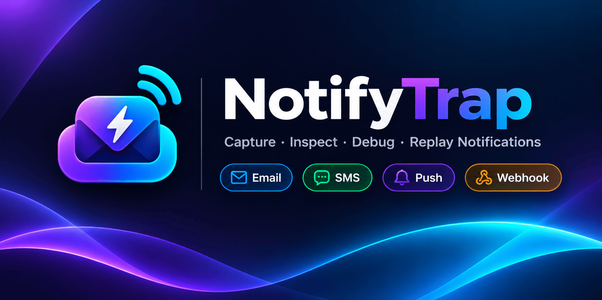

<div class="nt-banner-frame">
  
</div>

## نصب سریع

نصب‌کننده‌های زیر آخرین نسخه منتشرشده را مستقیم از GitHub Releases دانلود و نصب می‌کنند:

::: code-group

```bash [macOS / Linux]
curl -fsSL https://raw.githubusercontent.com/farshidrezaei/notifytrap/main/scripts/install.sh | bash
```

```powershell [Windows (PowerShell)]
irm https://raw.githubusercontent.com/farshidrezaei/notifytrap/main/scripts/install.ps1 | iex
```

:::

> [!IMPORTANT] بدون ارسال واقعی
> **NotifyTrap هرگز پیام واقعی به بیرون ارسال نمی‌کند.** تمام ایمیل‌ها، SMSها، Pushها و Webhookها درون محیط امن توسعه شکار و در SQLite لوکال ذخیره می‌شوند.
